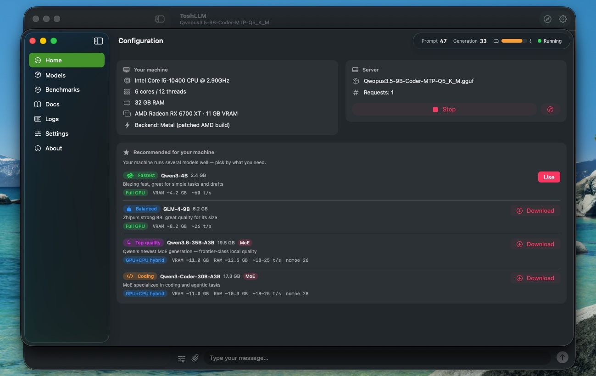
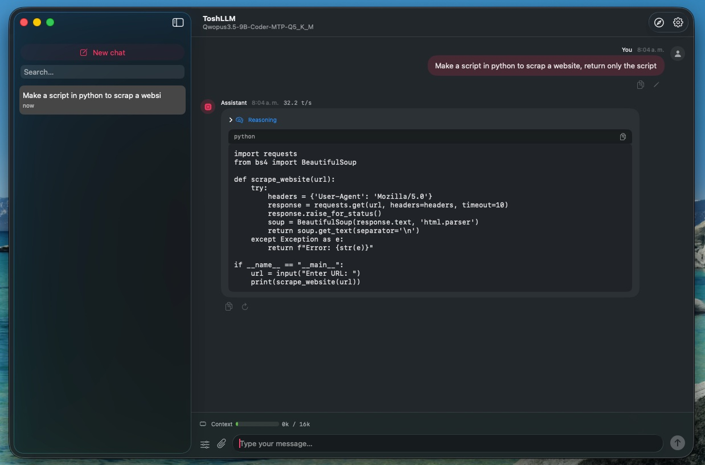
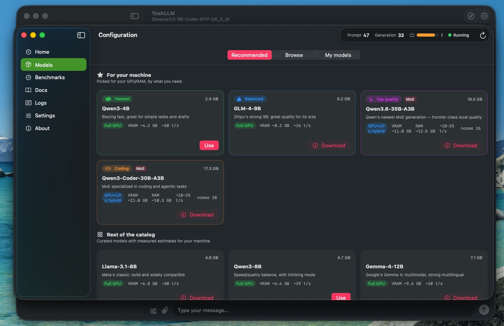
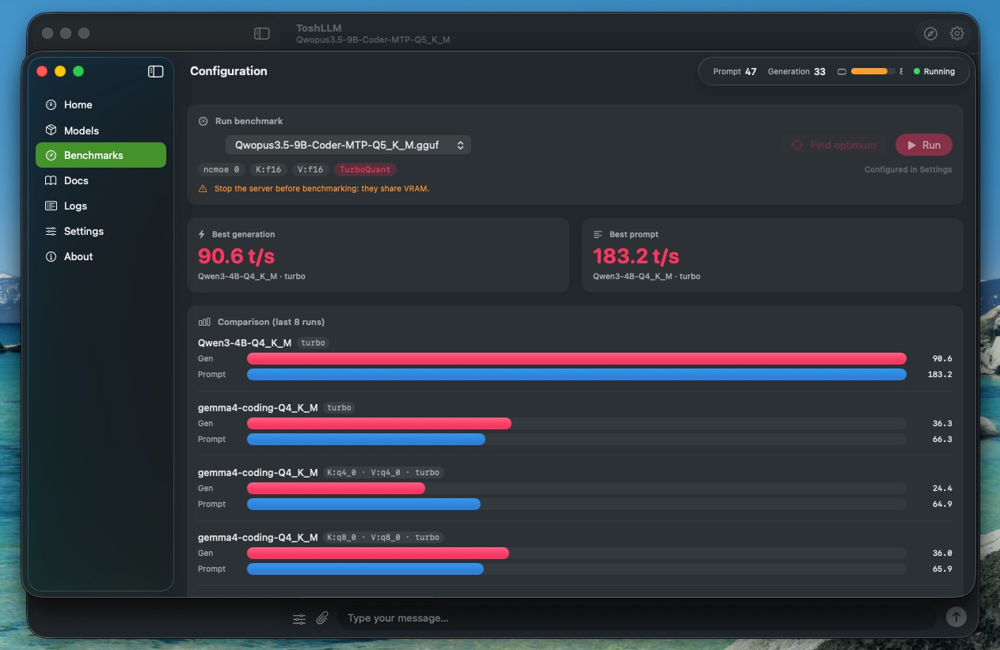

<div align="center">

# ToshLLM

**Run large language models locally on Intel Macs with AMD GPUs.**

Native macOS app · Metal acceleration · No cloud, no accounts, no per-token costs

[](https://github.com/engeldlgado/toshllm/actions/workflows/build.yml)
[](LICENSE)
[-lightgrey)](#requirements)
[](https://github.com/engeldlgado/toshllm/issues)
[](#support-the-project)
[](https://doi.org/10.5281/zenodo.21908524)

### [⬇️ Download the latest release](https://github.com/engeldlgado/toshllm/releases/latest) · [📝 Changelog](CHANGELOG.md)

*[Versión en español más abajo](#toshllm-en-español)*



</div>

---

## What is ToshLLM?

ToshLLM lets you run modern open LLMs **entirely on your own Mac** — your chats never leave the machine, there are no accounts, and there's nothing to pay per token.

Most local-LLM tools on macOS only target Apple Silicon. Intel Macs with discrete AMD GPUs — including Hackintosh builds — get left behind: the stock engines produce **corrupted output** on AMD dGPUs and read model weights over PCIe at a fraction of the possible speed.

**ToshLLM fixes that.** It bundles `llama.cpp` built with AMD-specific patches and wraps it in a polished native SwiftUI app — so a card like the RX 6700 XT goes from unusable to genuinely fast:

| | Stock llama.cpp on AMD dGPU | ToshLLM |
|---|---|---|
| Output | corrupted | correct |
| Qwen3-8B generation | 0.6–2.6 t/s | **~61 t/s** |
| Qwen3.6-35B (MoE) generation | unusable | **~29 t/s**, flat on long runs |

It opens, detects your hardware, and recommends models that will actually run well — no guesswork.

## Polaris performance work (RX 580 / `gfx803`) 🧪

> ⚠️ One card, one model, one branch. Measured on an **AMD Radeon RX 580 (GCN 4 / `gfx803`, 36 CUs,
> 8 GB)** with `Ornith-1.5-9B-heretic-Q4_K_M` (5.23 GiB, q4_K weights + q6_K output/FFN-down),
> Flash Attention on and a q4_0 KV cache. Not reproduced on any other card or driver.

`llama-bench -ngl 99 -fa 1 -ctk q4_0 -ctv q4_0 -b 2048 -ub 1024 -pg 512,128 -r 4 -t 10`, on a quiet
and warmed card, base and tuned alternated in one session:

| build | pp512 | tg128 |
|---|---:|---:|
| upstream engine, no Polaris work | 100.5 | 22.4 |
| this branch | **167.5** | **26.7** |
| same card under Linux/RADV, official llama.cpp | 206.6 | 29.2 |

So **+66.7% prefill and +19.0% decode** over what this branch started from, with 19% of prefill and
8.7% of decode still to give before the Metal path matches Linux on identical silicon.

**The kernel changes that got there.**

- **Float accumulators in the tiled prefill matmul.** GCN4 round-trips a half-precision product
  through the register file on every accumulate step; accumulating in fp32 is worth **+22%** on its
  own — the largest single change in the whole effort.
- **One wavefront per tile, eight output columns per lane, two loads prefetched** in that same
  tile: 2.03 → 2.97 TFLOP/s standalone at `12288×4096`. Reordering the panel loads and splitting the
  tile-order dependency added a further few percent in situ.
- **16-byte vectorised activation reads in the wave64 decode mat-vec**, four `float4` instead of
  sixteen scalars — the shape RADV's shader emits — for **+6.6% decode** at the same traffic.
- **Decode geometry chosen per shape and type**: rows per group and lanes per block are not one
  constant. q4_K wants sixteen lanes and four rows at the FFN widths, q6_K wants four rows and eight
  rows at different row counts, and the wave64 kernels are separate entry points from the wave32
  ones rather than the same code with a different warp size.
- **Fusions on the decode path**: swiglu, RMS-norm and norm-add folded into the q4_K mat-vec itself
  (worth +3.7%, +1.7% and +1.4% respectively when switched back off to measure), and a dispatch-fusion
  pass over the tail of tiny elementwise kernels that a decode token issues several hundred of.
- **A wave64 flash-attention path** covering quantized KV, plus shared-dequant multi-column mat-vec
  kernels so a batched step reads and unpacks each weight block once instead of once per column.
- **Alignment and architecture probed, never assumed.** Cards older than Vega return the aligned
  bytes for a dword read on a word boundary, so the fast unaligned path is granted only to hardware
  measured to tolerate it, by `amdgpu_gfx<N>` ISA target where the OS reports one and by device name
  where it does not. Unknown hardware stays correct rather than fast.

## Features

- **Native chat** — multiple persistent conversations, full Markdown with code-copy, regenerate, system prompt, live tokens/sec, file attachments, conversation forking and per-message metrics
- **Agent tools and MCP** — the model can read, edit and run files and commands with per-step permission, run JavaScript in a sandbox, and use tools from external Model Context Protocol servers you connect
- **Symbolic math (SymPy)** — optional exact math tools for the model: simplify, solve equations and systems, derivatives, integrals, limits, series, differential equations, matrices, Laplace and Fourier transforms, and checking that two expressions are equivalent or that a solution holds. The runtime ships inside the app, nothing else to install; off by default, in chat settings under Agents ([details](helpers/tosh-sympy/README.md))
- **Scientific computing (NumPy and SciPy)** — optional numerical tools for the model: definite integrals without a closed form, roots, optimization and curve fitting, differential equations over an interval, linear algebra on decimal matrices, FFT and filters, and statistics. The model sends an operation and its numbers, never code. Same bundled runtime, its own switch, off by default ([details](helpers/tosh-scientific/README.md))
- **Math answers you can check** — with either math tool set on, the engine runs the turn itself: a calculation has to go through a tool or a question back, every call is checked against your message, and the answer only states numbers from your message or from a validated result. The app's chat, the web chat and any OpenAI client that sends `X-Tosh-Agent: on` get the same agent, also from another computer; requests that bring their own tools get the model as it is ([how to call it](helpers/tosh-sympy/README.md#four-ways-to-reach-the-tools))
- **GPU speech and subtitle studio** — Whisper.cpp transcribes microphone dictation into one clean paragraph, while the Audio workspace can disable Silero VAD, use Whisper.cpp's native defaults or tune it with calibrated profiles, previews audio or video with a synchronized editable transcript, preserves recoverable original and translated tracks, keeps Chat translation consistent with context and a glossary, and exports SRT, VTT, TXT, JSON or a captioned MOV; nothing leaves the Mac
- **Vision** — attach images (or paste a screenshot with Cmd+V) and vision-capable models describe them; the matching projector (`mmproj`) is paired automatically
- **Image generation (beta)** — a local text-to-image studio (stable-diffusion.cpp on the same AMD Metal stack): text-to-image and image-to-image, with a model catalog sized to your VRAM, a live preview of the image forming, and an **upscaler** that takes your own photos too (x2/x4, batches, and a drag-to-compare view)
- **Model manager** — a curated catalog with **per-model VRAM/RAM estimates for *your* hardware**, plus Hugging Face browsing sorted by trending, downloads, likes or last update, downloads with live progress, and a flag when a repo re-publishes a model you already have
- **MoE-aware** — automatic `--n-cpu-moe` calculation so 35B-class Mixture-of-Experts models run well on 12 GB GPUs
- **Speculative decoding, automatic and lossless** — MTP engages by itself on models that ship the head, and DFlash uses a small per-model draft when one is downloaded; both size themselves to your VRAM, back off on content where drafting doesn't pay, and never change the output
- **Bundled engine** — official llama.cpp with the **AMD Flash Attention kernel** on by default, so attention runs on the GPU instead of falling back to the CPU (see the [research note](#research-amd-gpus-on-metal))
- **Benchmarks** — measure prompt/generation speed per configuration, with history and side-by-side comparison charts
- **OpenAI-compatible API** — use it at `http://127.0.0.1:8080`, with optional local-network access and Bonjour discovery; can also serve embeddings for local RAG clients
- **Router mode** — one server that auto-loads whichever model each OpenAI-compatible request names, no restart between models; external clients and the built-in chat switch on the fly
- **Multiple servers** — run several independent engine instances at once from the Dashboard, each with its own model, GPU, port and profile; serve different models side by side or pin one model per GPU
- **Multi-GPU and eGPU** — split a model across all your GPUs or an exact set of cards (validated on dual-GPU setups); external GPUs run at full speed with VRAM-resident weights
- **Every parameter explained** — bilingual tooltips and built-in docs (English/Spanish)
- **Profiles, menu bar mode, auto-start** — save full configurations and switch with one click

### In testing 🧪

These are new and still being validated — enable them in Settings, but expect rough edges:

- **Dynamic MoE (off by default)** — for Mixture-of-Experts models that do not fit in VRAM: the most used experts stay in VRAM, the rest in RAM, sized for your context and for the memory the Mac has free right now, and the model is not loaded when nothing fits safely. On an RX 6700 XT it reads prompts nearly twice as fast as the standard offload on Qwen3.6-35B-A3B and generates about 50% faster. Off, MoE models use the standard offload as before. [How it works](#dynamic-moe-experimental-off-by-default).
- **Video generation (experimental, first cut)** — a Video mode next to Chat and Images, on the same stable-diffusion.cpp engine, with Wan 2.1/2.2, LTX-2 and HunyuanVideo. Read this before downloading 7 GB: a few seconds of video take minutes, 49 frames at 480p already fill a 12 GB card, and **only Wan 2.1 1.3B fits one at all** — the others ask for 24 GB or more. Asking for more frames or more pixels than fit fails instead of degrading. The clip comes back as frames you can scrub, and exports to mp4. The engine side is measured; the interface is new and the defaults will move.
- **Remember conversations (disk cache)** — persists each chat's KV cache so reopening it, or restarting the app, skips re-processing the prompt; the reload is byte-exact, and an 8.6k-token chat comes back in 0.9 s instead of 24.8 s of re-prefilling. Also pre-warms the cache for external clients (VS Code/Cline), so their first request skips the multi-minute cold prefill.
- **Prompt cache reuse** — reuses the cache across mid-prompt edits (coding assistants) and trimmed reasoning instead of reprocessing. Fast but approximate; toggle it off in Settings for exact, reproducible output.
- **Split model across GPUs** — validated on a dual-GPU setup (RX 6900 XT + RX 6800 XT eGPU): a 35B MoE with all experts in VRAM generated at ~3× the single-GPU-offload speed, and testers run 122B-class models across four cards. You can pick the exact set of cards per server; it stays flagged experimental in the UI while more configurations report back.
- **Tensor split (`--split-mode tensor`)** — splits every tensor instead of assigning whole layers per card, so both GPUs work on the same token. Now selectable in Settings, next to the fast event hand-off it needs (on by default with a split). It costs one all-reduce per layer, a fixed price per token: a 14B still generates faster split by layers, while a 27B on a dual card gains in both phases (281 → 377 t/s prompt, 8.1 → 11.6 generated). Within the all-reduce the transfer is chosen per batch, the Infinity Fabric peer copy for prompts and events for generation.

### A native chat that stays out of your way

Persistent conversations, Markdown with one-click code copy, and a live tokens/sec readout so you always know how fast the model is going.

<div align="center">
  
</div>

### Models picked for your machine

ToshLLM reads your GPU and RAM and suggests models by use case — fastest, balanced, top quality, coding — each with an honest estimate of how it'll run. Browse a curated catalog or search Hugging Face directly.

<div align="center">
  
</div>

### Measure it on your own hardware

The built-in benchmark runs prompt and generation tests for any configuration and charts them side by side, so you can find the sweet spot for your card.

<div align="center">
  
</div>

Measured on the development card (**RX 6700 XT 12 GB**, RDNA 2, bundled engine 0.85.5, KV f16, `pp512` / `tg128`):

| Model | Type | Prompt (t/s) | Generation (t/s) |
|---|---|---:|---:|
| Llama-3.2-1B Q4_K_M | dense | 5770 | 254 |
| gemma-3-4B Q4_K_M | dense | 1751 | 89 |
| Qwen3-4B Q4_K_M | dense | 1562 | 98 |
| Qwen3-8B Q4_K_M | dense | 851 | 61 |
| Qwen3.5-9B Q4_K_M | dense | 743 | 52 |
| gemma-4-12B Q4_K_XL | dense | 534 | 37 |
| Qwen3.6-14B-A3B Q5_K_M | MoE, all experts in VRAM | 1243 | 67 |
| gpt-oss-20B Q4_K_M | MoE, all experts in VRAM | 1305 | 94 |
| gemma-4-26B-A4B MXFP4 | MoE, `--n-cpu-moe 16` | 595 | 25 |
| Qwen3.6-35B-A3B Q4_K_S | MoE, `--n-cpu-moe 24` | 475 | 29 |

Numbers vary with quant, context depth and cooling; the app records your own history so you can compare configurations directly.

For scale, the same gpt-oss-20B run against the Apple Silicon numbers posted in llama.cpp's gpt-oss guide, same flags (`-ngl 99 -t 1 -fa 1 -b 2048 -ub 2048`):

| test | RX 6700 XT | [Mac mini M4 Pro 64 GB](https://github.com/ggml-org/llama.cpp/discussions/15396#discussioncomment-14226807) | [MBP M3 Max 128 GB](https://github.com/ggml-org/llama.cpp/discussions/15396#discussioncomment-14224424) | [M4 Max 36 GB](https://github.com/ggml-org/llama.cpp/discussions/15396#discussioncomment-14225207) |
|---|---:|---:|---:|---:|
| pp2048 | 1233 | 701 | 1348 | — |
| pp8192 | **1088** | 619 | 1040 | — |
| pp16384 | **919** | 535 | 908 | — |
| pp32768 | **610** | 420 | 531 | — |
| tg128 | 95.0 | 63.3 | 64.3 | 95.9 |

A 2021 card holds its own: it trails the M3 Max on short prompts, leads it from 8k tokens up, and generates at the same rate as an M4 Max. Two things to keep in mind. The M3 Max `tg128` is low because that run was heat throttled, as the maintainer notes in the linked reply, so the M4 Max figure is the one to compare generation against; both it and the run here measured generation on its own, which is what avoids the throttling. And the file is not the same: theirs is the stock MXFP4 build, ours a `Q4_K_M` repack. That matters less than the name suggests, because **87% of our file is still MXFP4** — the 72 expert tensors keep the model's native format, and only the remaining 13% (attention, embeddings, norms) is repacked to Q8_0/Q5_0/Q4_K, which is why it weighs 10.81 GiB against their 11.27.

## Install

1. **[Download the latest `.dmg`](https://github.com/engeldlgado/toshllm/releases/latest)**, open it, and drag **ToshLLM** to Applications.
2. The app is fully self-contained — the inference engines ship inside the bundle. No Homebrew, no Python, nothing else to install.

> **First launch:** from 0.86.5 the app is signed with an Apple Developer ID and
> notarized by Apple, so it opens straight away with no warning and nothing to
> approve. On **0.86.4 and earlier** macOS blocks the first open: go to
> **System Settings → Privacy & Security** and click **"Open Anyway"**, or run
> `xattr -dr com.apple.quarantine /Applications/ToshLLM.app`.

> **Older Macs without AVX2 (e.g. Mac Pro 5,1 and other pre-2013 Xeons):** the normal build needs the AVX2 CPU instructions and will crash on launch with "illegal hardware instruction" on those machines. Each release also ships a dedicated **no-AVX2 build** — download the `.dmg` whose name ends in **`-noavx2`**. It updates on its own channel, so once installed it will only ever offer you no-AVX2 builds.

## Requirements

- macOS 14 or later
- An Intel Mac with an AMD GPU that supports Metal (developed and tuned on an RX 6700 XT 12 GB)
- 16 GB RAM minimum — 32 GB recommended for 35B-class MoE models

> **Hackintosh note:** AMD RDNA 2 dGPUs work great with the [NootRX](https://github.com/ChefKissInc/NootRX) kext providing Metal support. ToshLLM runs on top of any working Metal setup. If your OpenCore config injects `ATY,Henbury` in `DeviceProperties`, try removing it: on an RX 6600 XT it cut generation from about 20 to 14 tokens a second ([#44](https://github.com/engeldlgado/toshllm/issues/44)). It was a workaround for macOS 12.3 and is only needed if your displays depend on it.

## Good to know

ToshLLM is **beta** and under active development. It's solid for daily use, but you may still hit rough edges — please report anything you find in [Issues](https://github.com/engeldlgado/toshllm/issues) (you can export diagnostics from **Settings → Server log**). Two limitations are worth knowing up front:

- **External clients (VS Code Copilot, Cline, Continue…):** these send a fixed 15–19k-token prompt (system instructions + tool definitions) with *every* request. On GPUs without Metal Flash Attention that means minutes of prompt processing per cold request, which saturates the GPU and can thermally throttle it. Recent versions mitigate this (single slot with resumable prefill, prompt-cache reuse, inline reasoning) and more is on the way. The built-in chat isn't affected — it only sends your conversation.
- **Vision cache:** `llama.cpp` does not support saving/restoring slots or cache-reuse while an `mmproj` is loaded. ToshLLM disables those features automatically for vision models; normal in-memory prompt caching still works.
- **Large MoE models on AMD GPUs:** Mixture-of-Experts models that don't fully fit in VRAM (e.g. 26B/35B with `--n-cpu-moe` offload) cross the CPU↔GPU boundary many times per token. This used to slowly starve the AMD driver and stall generation mid-answer, but **0.81.49 fixed it** with a persistent staging buffer (see [Persistent staging](#persistent-staging-flat-sustained-generation) below) — these models now run flat and stable, confirmed on an RX 6700 XT and on a tester's dual-GPU Mac Pro, with no deadlock observed since. A **watchdog** stays in as a safety net, and dense models are still the simplest choice, but large MoE-with-offload is no longer something to avoid.
- **Vision (image input):** works across the Qwen3-VL family (Qwen3-VL-2B, Qwen3.5-9B, Qwen3.6-14B/35B), Gemma 3 and Gemma 4. Since 0.82.0 the AMD attention kernel covers the vision encoders too (they attend bidirectionally, with no mask, at head dims 64 and 72), so describing an image costs ~250–360 MB of VRAM instead of 3.4–4.7 GB — the fallback path materializes the whole attention matrix. Note that reasoning models (Qwen 3.5/3.6) place the image description in their thinking output, which the in-app chat shows but some external clients may not.

## Build from source

Prerequisites: Xcode Command Line Tools (`xcode-select --install`), CMake.

```bash
git clone https://github.com/engeldlgado/toshllm
cd toshllm
./scripts/build-engines.sh      # clones llama.cpp, applies AMD patches, builds static engines
./make-app.sh                   # builds the SwiftUI app and packages dist/ToshLLM.app
./scripts/make-dmg.sh           # optional: create an installable DMG (version from the VERSION file)
./scripts/test.sh               # optional: run the unit tests (needs Xcode for XCTest)
```

The AMD patch lives in [`patches/`](patches/) — chunked staging transfers for Metal drivers that cap host-visible allocations (also covering the asynchronous tensor read path that MTP exercises, which previously aborted mid-generation), plus a persistent staging buffer that keeps long generations from slowly drowning the AMD driver (see the [research note](#persistent-staging-flat-sustained-generation)). The other key stability setting (`GGML_METAL_CONCURRENCY_DISABLE`) is already supported upstream and the app sets it automatically.

## Research: AMD GPUs on Metal

### Dynamic MoE (experimental, off by default)

A Mixture-of-Experts model only uses a few experts per token, so it does not need all of them in
VRAM. With **Settings → Performance & Memory → Dynamic MoE (experimental)** turned on, the bundled
engine plans memory for MoE models itself: the most used experts live in a VRAM arena, the rest of
the expert bank stays in RAM, and routed experts are uploaded as needed. Off, MoE models keep the
standard expert offload (`--n-cpu-moe`) exactly as before. The switch is `--dynamic-moe on` on the
engine's command line.

When it is on, the planner reads the model (every file of a split GGUF), probes the memory each
layout needs without loading weights, and looks at how much RAM the Mac can give right now, not
only at how much it has. It then picks one of:

| plan | when |
|---|---|
| Full GPU | the model and the requested context fit in VRAM with a safe margin |
| Dynamic MoE, full host | the whole expert bank fits in RAM next to everything else |
| Dynamic MoE, bounded host | free RAM is short: RAM keeps the most used experts and the rest are read from the model file |
| Expert offload | the classic `--n-cpu-moe` layout is the only safe one left |
| No safe plan | the model is not loaded, and the engine says what it needed and what was available |

A bounded plan reports its coverage, (VRAM arena + RAM cache) / expert bank: 1.25 or more is
comfortable, 1.0 to 1.25 works with slower prompts, and under 1.0 is refused. The planner checks
memory again right before it commits, so another app taking memory during the few seconds of
planning makes it plan again; it also leaves room for the server's prompt cache and conversation
checkpoints. The plan, with projected RAM, VRAM and coverage, is shown before the model starts, and
the measured memory once it is running.

Validated on Qwen3.6-35B-A3B, GPT-OSS 20B, Gemma 4 26B-A4B and GLM-4.7-Flash-REAP on an RX 6700 XT
(32 GB RAM), and on the 104 GB split Qwen3.8 Flash Next on one Radeon Pro Vega II die. Other MoE
architectures may work but are not validated. Reference speeds on the RX 6700 XT, 3.4K-token prompt,
Dynamic MoE with the full bank in RAM against the standard offload:

| model | prompt t/s (standard → Dynamic MoE) | generation t/s |
|---|---|---|
| Qwen3.6-35B-A3B | 310.6 → 580.6 | 29.0 → 43.8 |
| GPT-OSS 20B | 496.7 → 901.9 | 40.7 → 68.1 |
| Gemma 4 26B-A4B | 384.6 → 595.3 | 22.5 → 38.8 |
| GLM-4.7-Flash-REAP-23B | 411.6 → 401.8 | 28.5 → 30.9 |

With less free RAM, bounded plans trade prompt speed for memory: Qwen with 8 GB held by other apps
runs a 12.9 GiB RAM cache at coverage 1.12, 365.8 t/s on the first prompt and 31.2 t/s generating,
in 13 GiB of RAM instead of 22. Measurements and the reasoning behind each limit are in
[`research/bounded-host-residency`](research/bounded-host-residency/).

### Flash Attention (decode)

A recurring limitation on discrete AMD GPUs under Metal is that **Flash Attention** is gated on hardware features these GPUs report as unavailable (`simdgroup matrix multiply`), and the upstream "vec" decode kernel miscompiles on RDNA 2 (it produces garbage even though each SIMD primitive is correct in isolation). The practical consequence: any quantized KV cache **requires** Flash Attention, so on AMD that attention silently falls back to the CPU and generation collapses at longer contexts.

ToshLLM ships a from-scratch **AMD attention kernel** (Metal) as a toggle next to the standard Flash Attention setting. It keeps a deliberately simple structure (one `float4` slice of the head per SIMD lane, simdgroups splitting the KV stream, online-softmax merge) that was validated bit-for-bit against a CPU reference. It supports head dims **64, 72, 128, 256 and 512** (72 covers the vision encoders, which are bidirectional and carry no mask) and KV types **f16, q8_0, q4_0** in **any keys/values combination**, so you can compress keys while keeping values at full precision, all on the GPU. The distinction the toggle makes explicit: standard Flash Attention runs on the CPU on AMD GPUs, this kernel runs on the GPU.

The kernel splits the KV stream across as many simdgroups as the threadgroup-memory budget allows (32 for head dim 128, 16 for 256, 8 for 512 — the head dim Gemma 4's global layers use), turning the long serial decode loop into short parallel ones — a win that grows with context depth. On an RX 6700 XT with a quantized KV cache, generation at 4096 tokens of context improves from 19 → 33 t/s on an 8B (+75%) and 26 → 31 t/s on the 9B coder (+17%); at 2048 tokens, +42% and +11%. Prompt processing stays within ~3% and output is bit-for-bit unchanged.

Measured on an RX 6700 XT (decode, `tg`, llama-bench), GPU kernel vs the CPU fallback that quantized KV would otherwise force:

| Model / KV | context | CPU fallback | AMD kernel |
|---|---:|---:|---:|
| Qwen3-8B, f16 (head 128) | 1k | 7.1 t/s | **43.4 t/s** |
| Qwen3-8B, q8_0 (head 128) | 1k | 3.9 t/s | **30.3 t/s** |
| 9B coder, q8_0 (head 256) | 1k | 13.6 t/s | **30.8 t/s** |

The same kernel handles **prompt processing** too: although it is the "vec" decode kernel rather than the matrix-unit "mm" kernel a fully-equipped GPU would use for prefill, running it on the GPU still crushes the CPU fallback that quantized KV would otherwise force — and, unlike the CPU path, it stays flat with depth:

| KV (8B), prompt processing | pp2048 CPU | pp2048 AMD kernel |
|---|---:|---:|
| q8_0 | 40 t/s | **100 t/s** |

It is on by default (a toggle in Settings turns it off). Vulkan/MoltenVK was also evaluated as an alternative backend and did not justify shipping (Metal wins on prompt throughput and matches generation).

### Quantized KV cache: memory vs speed

With the AMD attention kernel running on the GPU, quantizing the KV cache stops being a trap on these cards (it no longer forces attention to the CPU), so it becomes a real lever for fitting long context into limited VRAM. Measured on an RX 6700 XT with **Qwen3-8B (Q4_K_M)**, the hard case — prompt processing *and* generation on top of a 2048-token context (`pp2048 @ d2048`, `tg128 @ d2048`, llama-bench, cooled runs):

| KV type | pp @ depth (t/s) | tg @ depth (t/s) | KV at 32k ctx |
|---|---:|---:|---:|
| f16    | 120 | **54** | ~4.6 GiB |
| q8_0   | **195** | 53 | ~2.4 GiB |

Two things stand out. Prompt processing at depth is *faster* with a quantized cache than with `f16`, because attention reads a smaller KV (less bandwidth). And `q8_0` matches `f16` generation speed while halving the KV footprint — a free win for long context, and you can quantize both keys and values, not just keys.

Below `q8_0` the bundled engine also offers the **TurboQuant** KV types ([Google Research](https://research.google/blog/turboquant-redefining-ai-efficiency-with-extreme-compression/), Turbo3 and Turbo4), which pack the cache further with cooperative GPU writes, cache reuse and context shifts intact; the AMD attention path covers head sizes from 128 through 640 on wave32 and wave64.

**Where you spend the bits matters more than how many.** Perplexity on wikitext, same card, against `f16`:

| keys / values | bits per channel | Qwen3-4B | Qwen3-8B | Qwen3.6-35B MoE |
|---|---:|---:|---:|---:|
| `q8_0` / `q8_0` | 8 | −0.1% | +0.0% | +0.0% |
| **`q8_0` / Turbo4** | **6** | **−0.7%** | **+0.2%** | **+0.4%** |
| `q8_0` / Turbo3 | 5.5 | +0.5% | +0.6% | +0.8% |
| Turbo4 / Turbo4 | 4 | +5.7% | +3.5% | +0.3% |
| Turbo3 / Turbo3 | 3 | +50% | +9.2% | +0.7% |

Quantizing the **keys** is what costs quality on dense models, and the smaller the model the more it costs: at equal budget, `q8_0` keys with Turbo3 values costs 0.5% on a 4B where Turbo3 on both costs 50%. Large MoE models behave the other way round — there the keys barely matter and the values set the floor. So **`q8_0` keys with Turbo4 values** is the setting to reach for: indistinguishable from `f16` at every size measured, a quarter less cache than `q8_0`, and generation within ~3% of it. Settings suggests it for you. Turbo on both is worth it only on large models, where it holds quality at half the bits.

### ToshGEMM: tiled prefill matmul on AMD

Prompt processing on AMD was stuck on the slow matrix-vector path, because Metal's matrix-unit `mul_mm` kernel uses `simdgroup_matrix`, which AMD GPUs can't run (it crashes). **ToshGEMM** is a from-scratch tiled matrix-matrix kernel that restores the fast prefill without those cooperative ops. It is auto-selected on AMD RDNA (wave32); Apple Silicon and AMD GCN are unaffected, and it reverts with `GGML_METAL_MM_MANUAL_DISABLE=1`. Output is byte-identical and generation speed is unchanged.

Prompt processing on an RX 6700 XT (Qwen3-8B Q4, pp512, t/s, before → ToshGEMM):

| | with Flash Attention | without FA (raw matmul) |
|---|---|---|
| pp512 | 93 → **228** (2.4×) | 99 → **342** (3.4×) |

For a 1000-token prompt that cuts time-to-first-token from ~10 s to ~4 s.

Later upgrades pushed it further. The kernel does its math in **packed half precision**, which AMD cards execute at twice the rate; its K tiles are double-buffered; and the AMD attention kernel prefills in blocks of 16 tokens that share the stored context instead of each token re-reading all of it. Measured on 0.83.12 on the same card, **pp512 on the 8B reaches 764 t/s** — 8× the pre-ToshGEMM baseline — so that 1000-token prompt is down to ~1.3 s to first token, and prompt processing stays fast deep into a conversation instead of degrading with context.

That double buffering alternates two 8 KiB threadgroup tiles, so the synchronization that publishes the next tile also lets slower simdgroups finish consuming the current one: an interleaved A/B on Qwen3-8B Q4_K_M averaged **+2.49%**, and the image engine, which shares the path, cut warm SDXL Turbo sampling from 3.10 s to 3.01 s with byte-identical PNGs. Set `GGML_METAL_MM_DOUBLE_BUFFER_DISABLE=1` to keep ToshGEMM but disable only this. The expert (`mul_mm_id`) path stays single-buffered: it passed 790/790 correctness cases but measured 1.2% slower with the extra threadgroup memory at `--n-cpu-moe 20`.

ToshGEMM now also covers **Mixture-of-Experts** prefill: the per-expert matmul (`mul_mm_id`) uses the same tiled kernel, so MoE models get the speedup on whatever experts are GPU-resident, not just their dense/attention layers. On a Qwen3-Coder-30B-A3B (Q4_K_M, pp512, RX 6700 XT, `--n-cpu-moe 20`):

| path | pp512 (t/s) |
|---|---|
| matrix-vector (no ToshGEMM) | 90 |
| dense layers only | 102 (+12%) |
| dense **+ MoE experts** | **124 (+37%)** |

So the expert matmul adds the larger share (+22% on top of dense) once experts sit on the GPU. That share scales with how many experts fit in VRAM — small when most are offloaded to CPU (the usual case on 12 GB cards), larger on higher-VRAM GPUs. Output stays coherent. *Measured on a single RX 6700 XT; still needs more everyday-use testing across models and VRAM sizes.*

### Persistent staging: flat sustained generation

On discrete GPUs the weights live in private VRAM buffers, so every CPU↔GPU tensor copy used to wrap the caller's host pointer in a fresh `MTLBuffer` — one new kernel graphics resource per copy. Dense models barely notice (one logits read per token), but MoE models with experts on the CPU cross that boundary dozens of times per token, and multi-GPU splits cross it on every layer hand-off. The AMD driver accumulates those resources faster than it retires them, so a long reasoning or vision answer slowly loses speed and can end with the driver wedged — the engine stalls, and on setups where the same GPU drives the display the whole machine appears frozen. Captured live on a stalled process: 11,000+ IOAccelerator regions, stuck inside `IOAccelResourceCreate`.

Since 0.81.49 the engine routes small transfers through one persistent staging buffer per device (blit + memcpy, zero new resources per copy); large one-shot transfers (model load, KV persistence) keep the direct path. Measured on an RX 6700 XT with Qwen3.6-35B-A3B (Q4_K_S, experts on CPU):

| | before | after |
|---|---:|---:|
| pp512 | 155.3 ± 7.7 t/s | **179.9 ± 0.2 t/s** |
| tg128 | 18.2 ± 1.4 t/s | **23.3 ± 0.4 t/s** |
| sustained reasoning (2200 tokens) | 14 → 5.7 t/s, then a full stall | **~21–22 t/s, flat** |

Dense models gain ~4% and were never at risk (too few copies per token). The prompt-processing gain has the same source: each large batched copy used to pin megabytes of host memory per call. The variance collapse (±7.7 → ±0.2) shows the churn was also where the run-to-run noise came from.

### AMD GCN / Vega cards (RX 500-series, Vega, Radeon VII)

These older AMD GPUs use a 64-wide wavefront ("wave64"), while llama.cpp's Metal kernels assume 32 — that mismatch produced garbage output, and GCN has no simdgroup-matrix or simdgroup-reduction units, so it can't run the stock fast paths at all. ToshLLM ships a **custom wave64 GPU path**, turned on automatically when a wave64 card is detected, and it now covers the whole model: weight decode (K-quants including Q2_K/Q3_K, the IQ and MXFP4 types, the Q4_0/Q4_1/Q5_0/Q5_1 legacy quants, the ternary Q1_0/Q2_0, bf16, and Mixture-of-Experts expert math), the reductions (softmax and normalization, plus sums, argmax and the SSM scan that Mamba-style models and speculative decoding need), the Gated Delta Net layers the Qwen3.5/3.6 family is built on, **attention** (the AMD kernel has wave64 variants since 0.81.55, quantized KV included, and since 0.83.10 prompt processing uses the blocked kernel instead of decomposing attention), and the prompt matmul for both dense and expert layers.

The gains landed in three steps. `mul_mm_id` in 0.81.67 took a 35B MoE's prompt speed from 167 to **285 t/s (+70%)** on a Vega II. Then 0.83.9 moved the remaining quant types off the CPU: on a Radeon RX Vega 64, Qwen3 4B Q3_K_M went from **3.96 to 44 t/s** of generation, and gpt-oss 20B reached 18.2 t/s generation / 191 t/s prompt with the experts of 16 layers on the CPU. And 0.83.10 brought long prompts up on the same card, Qwen3 4B from **295 to 457 t/s at 8k of context** and Llama 3.2 1B from 917 to 1553, with identical perplexity.

Two contributed data points frame what to expect. On an **RX 580** a tester measured a K-quant model go from **1.3 t/s (CPU decode) to ~51 t/s (GPU decode)**, coherent. On a **Radeon Pro Vega II** (Mac Pro 2019), Qwen3.6-35B-A3B Q4_K_S with every expert in VRAM runs at **285 t/s prompt / 42 t/s generation**. Recommended on these cards: a K-quant model, Flash Attention left **ON** (not off), and the KV cache at f16 (q8_0 keys cost ~2% here, so it's a fair trade for long context). The GPU path is on by default; `GGML_METAL_WAVE64_DECODE_DISABLE=1` in **Extra arguments** falls back to the CPU, and `TOSH_W64_PREFILL_DISABLE=1` / `TOSH_W64_MMID_PREFILL_DISABLE=1` revert the two prompt-matmul routes if you want to compare.

#### Aligned reads on GCN before Vega, and a flag for testers

A weight block of 22, 34, 98, 110 or 210 bytes leaves every other one two bytes short of a word, so reading four of its bytes at once lands off a word boundary. Metal calls that undefined, and the GCN cards before Vega return the bytes of the aligned address instead, which turns a whole model to nonsense. Vega and RDNA happen to return the right bytes, which is why the wide read shipped without anyone noticing. Since 0.87.1 the mat-vec kernels take a pair of 16-bit reads on the cards that need it, chosen once at startup so the other cards keep the single read and the exact code they had.

Which card needs it is read from `MTLDevice.architecture`, the ISA target: `amdgpu_gfx803` is Polaris, `amdgpu_gfx900` and `amdgpu_gfx906` are Vega, and anything below gfx900 gets the aligned path. On macOS 12 and 13 that property does not exist and the card name decides instead, granting the fast path only to the names known to tolerate the wide read, so an unrecognised card stays correct rather than fast. The startup log always says which way it went and why:

```
ggml_metal: aligned mat-vec reads off by amdgpu_gfx906 (override with TOSH_MV_ALIGN=1 or =0)
```

`TOSH_MV_ALIGN` in **Extra arguments** forces either path on any card, and this is where reports help. If you have a GCN 3 or 4 card and want to know whether it really needs the aligned reads, run the engine check in the **Logs** tab with `TOSH_MV_ALIGN=0`: a card that needs them fails `MUL_MAT` on `q5_0`, `q6_K` and the other odd-sized types, and a card that does not passes clean and can join the fast list. Expect corrupt output while that flag is set on a card that needs alignment... it is a measurement, not a mode. The same applies in reverse on an unusual Vega-class card with `TOSH_MV_ALIGN=1`. Either result is worth [an issue](https://github.com/engeldlgado/toshllm/issues): the fast list can only grow from cards the project does not own.

> The wave64 path is validated on RDNA (wave32) as a byte-exact no-op, so it never affects Apple Silicon or AMD RDNA cards. On real GCN/Vega hardware it is still being validated with testers — if you have one of these cards, [your benchmark and coherence reports](https://github.com/engeldlgado/toshllm/issues) are exactly what moves it forward.

## Community benchmarks

Contributed by users on their own machines with the built-in benchmark (`pp512` / `tg128`). The cards and models differ per row, so read each one on its own rather than as a ranking:

| GPU | System | Model | Prompt (t/s) | Generation (t/s) |
|---|---|---|---:|---:|
| Radeon RX 6950 XT 16 GB | not reported | Qwen3-Coder-30B-A3B Q4_K_M — MoE, `ncmoe 23` | 587.3 | 47.8 |
| Radeon RX 6950 XT 16 GB | not reported | gemma-4-12B Q4_K_M — dense | 595.7 | 53.4 |
| Radeon Pro Vega II 32 GB (GCN) | Mac Pro 2019 — Xeon W 12-core, 96 GB | Qwen3.6-35B-A3B Q4_K_S — MoE, all experts in VRAM | 284.7 | 42.1 |
| Radeon Pro Vega II 32 GB (GCN) | Mac Pro 2019 — Xeon W 12-core, 96 GB | gemma-4-26B-A4B Q4_K_M — MoE | 190.3 | 47.9 |
| Radeon RX 6900 XT 16 GB | Mac Pro 2019 — Xeon W 16-core, 96 GB DDR4 | Qwen3-4B Q4_K_M — dense | 291.4 | 97.5 |
| Radeon RX 5600 XT 6 GB | Hackintosh — Core i5-12400F, DDR5 | Qwen3-4B Q4_K_M — dense | 100.0 | 52.1 |

Two of these rows carry a lesson. The 30B MoE on the 6950 XT jumped from 36 to 48 t/s once the tester let the app find the right expert offload (`ncmoe` 31 → 23) — that one setting is usually the difference between "fine" and "fast" on a MoE, and the **Find optimum** button in Benchmarks sweeps it for you. And the Vega II is a wave64 card: its 35B prompt speed went 167 → 285 t/s (+70%) in 0.81.67, when the expert matmul finally moved to the tiled GPU path.

Testers with several cards go much bigger: a **122B-A10B** MoE (Q5_K_M) across four W6800X GPUs runs at 226 t/s prompt / 26 t/s generation, and a **235B-A22B** (Q4_K_M) split over five mixed cards (Vega II Duo + W6800/W6800X) generates coherently at ~19.5 t/s.

### Share yours from the app

From 0.82.3 you can publish your numbers straight from **Benchmarks → Share with the community**. It runs the standard workload (`pp512` / `tg128`, three repetitions), shows you a summary plus the exact JSON, and only after you confirm submits it to [toshllm.com](https://toshllm.com). No GitHub or account is needed... each install signs its own submissions with a key kept in your Keychain, and you can reset that identity anytime. ToshLLM sends only the model identity, hardware description, configuration and the measurements... never local paths, account names, or chat content. Community results stay labeled until reproduced, and the project's own verified runs are marked separately. Sharing your numbers in an issue still works too.

## Architecture

```
ToshLLM.app
├── SwiftUI app (this repo) — UI, server lifecycle, downloads, estimator, benchmarks
└── Resources/
    ├── bin/        llama-server + llama-bench + llama-perplexity + the image engine (AMD-patched, static)
    └── test-ui/    minimal web chat served by llama-server
```

The app manages `llama-server` as a child process and talks to its OpenAI-compatible API. Hardware detection uses `sysctl` + Metal device enumeration; VRAM telemetry comes from IOKit.

## Contributing

Issues and pull requests are welcome — see [CONTRIBUTING.md](CONTRIBUTING.md). Please keep in mind the license below.

## License

**GPL-3.0** — see [LICENSE](LICENSE).

Free to use, study, modify and redistribute. Any distributed derivative must remain GPL-3.0 and preserve the copyright notice — the project can never be turned into closed-source commercial software.

Components bundled under their own licenses are listed in [THIRD_PARTY_NOTICES.md](THIRD_PARTY_NOTICES.md).

## Credits

- [llama.cpp](https://github.com/ggml-org/llama.cpp) (ggml-org) — inference engine
- [iRon-Llama](https://github.com/Basten7/iRon-Llama-RC1) (Basten7) — Metal-on-AMD research for Intel Macs
- [Chris Hafey](https://github.com/chafey) — the multi-GPU Mac Pros every split-model measurement runs on, and engine contributions
- Developed by **Engelbert Delgado** ([@engeldlgado](https://github.com/engeldlgado))

## Support the project

ToshLLM is free and open source, built in the open for the Mac AMD community. If it's useful to you, sponsoring keeps it independent and moving forward.

### 💜 [Become a sponsor](https://youpay.me/engeldlgado/bio)

Quick and friendly. Every contribution funds continued development. Thank you for being part of this.

Prefer crypto?

- **Binance Pay**: alias `engeldlgado`
- **USDT (TRC-20)**: `TFUG271bbbQEmFu4wkFHyvNNkYRZC5JDUf`

---

## ToshLLM en español

**Ejecuta modelos de lenguaje grandes localmente en Macs Intel con GPU AMD.** Aceleración Metal. Sin nube, sin cuentas, sin costos por token.

### [⬇️ Descarga la última versión](https://github.com/engeldlgado/toshllm/releases/latest) · [📝 Cambios](CHANGELOG.md) · [💜 Apoya el proyecto](#apoya-el-proyecto)

### ¿Qué es ToshLLM?

ToshLLM te permite ejecutar modelos LLM modernos **completamente en tu propio Mac** — tus chats nunca salen del equipo, no hay cuentas y no pagas por token.

Casi todas las herramientas de LLM locales en macOS apuntan a Apple Silicon; los Macs Intel con GPU AMD dedicada (incluidos los Hackintosh) quedan fuera: los motores estándar producen **texto corrupto** en estas GPUs y leen los pesos por PCIe a una fracción de la velocidad posible.

**ToshLLM lo resuelve.** Empaqueta `llama.cpp` con parches específicos para AMD dentro de una app nativa SwiftUI, de modo que una tarjeta como la RX 6700 XT pasa de inservible a realmente rápida (Qwen3-8B: de 0.6–2.6 t/s a ~61 t/s). Al abrirla detecta tu hardware y te recomienda modelos que correrán bien, sin adivinar.

### Funciones

- **Chat nativo** — conversaciones persistentes, Markdown completo con copiar código, regenerar, prompt de sistema, tokens/seg en vivo, adjuntar archivos, bifurcar conversaciones y métricas por mensaje
- **Herramientas de agente y MCP** — el modelo puede leer, editar y ejecutar archivos y comandos con permiso paso a paso, correr JavaScript en un sandbox y usar herramientas de servidores MCP externos que conectes
- **Matemática simbólica (SymPy)** — herramientas opcionales de matemática exacta para el modelo: simplificar, resolver ecuaciones y sistemas, derivadas, integrales, límites, series, ecuaciones diferenciales, matrices, transformadas de Laplace y Fourier, y verificar que dos expresiones son equivalentes o que una solución cumple. El runtime va dentro de la app, sin instalar nada más; apagado por defecto, en los ajustes del chat, en Agentes
- **Cálculo científico (NumPy y SciPy)** — herramientas numéricas opcionales para el modelo: integrales definidas sin forma cerrada, raíces, optimización y ajuste de curvas, ecuaciones diferenciales en un intervalo, álgebra lineal con matrices decimales, FFT y filtros, y estadística. El modelo envía una operación y sus números, nunca código. Mismo runtime incluido, con su propio interruptor, apagado por defecto
- **Respuestas matemáticas comprobables** — con cualquiera de las dos herramientas matemáticas encendida, el motor lleva el turno: un cálculo tiene que pasar por una herramienta o por una pregunta de vuelta, cada llamada se compara con tu mensaje y la respuesta solo da números de tu mensaje o de un resultado validado. El chat de la app, el chat web y cualquier cliente OpenAI que envíe `X-Tosh-Agent: on` usan el mismo agente, también desde otro equipo; las peticiones que traen sus propias herramientas reciben el modelo tal cual
- **Dictado por voz** — el botón de micrófono transcribe directo al cuadro de mensaje en el propio Mac (framework Speech de Apple); nada sale del equipo
- **Estudio de audio y subtítulos en GPU** — Whisper.cpp transcribe audio o vídeo, muestra y sigue el segmento activo durante la reproducción, conserva proyectos recuperables con original y traducción, mantiene términos consistentes mediante contexto y glosario, permite editar y comparar ambas pistas, prueba VAD en una muestra y exporta SRT, VTT, TXT, JSON o una copia MOV subtitulada
- **Visión** — adjunta imágenes (o pega una captura con Cmd+V) y los modelos con visión las describen; el proyector (`mmproj`) se empareja solo
- **Generación de imágenes (beta)** — estudio local de texto-a-imagen (stable-diffusion.cpp sobre el mismo stack Metal AMD): texto-a-imagen e imagen-a-imagen, con catálogo ajustado a tu VRAM, vista previa de la imagen formándose y un **escalador** que también acepta tus fotos (×2/×4, por lotes, y comparador con deslizador)
- **Gestor de modelos** — catálogo curado con **estimaciones de VRAM/RAM para *tu* equipo**, explorador de Hugging Face ordenable por tendencia, descargas, favoritos o última actualización, descargas con progreso y aviso cuando un repositorio vuelve a publicar un modelo que ya tienes
- **Soporte MoE** — cálculo automático de `--n-cpu-moe` para que modelos de 35B corran bien en GPUs de 12 GB
- **Decodificación especulativa automática y sin pérdida** — MTP se activa solo en los modelos que traen el cabezal, y DFlash usa un borrador pequeño por modelo cuando lo descargas; ambos se ajustan a tu VRAM, se desenganchan en el contenido donde no compensa y no cambian la salida
- **Motor integrado** — llama.cpp oficial con el kernel de **Flash Attention para AMD** activo por defecto, para que la atención corra en la GPU en vez de caer a CPU
- **Benchmarks** — mide velocidad de prompt y generación por configuración, con historial y gráficas comparativas
- **API compatible con OpenAI** en `http://127.0.0.1:8080`, con acceso opcional por red local y descubrimiento Bonjour; también puede servir embeddings para clientes RAG locales
- **Modo router** — un solo servidor que carga el modelo que pida cada petición compatible con OpenAI, sin reiniciar entre modelos; los clientes externos y el chat integrado cambian al vuelo
- **Varios servidores y multi-GPU** — varios motores independientes a la vez, cada uno con su modelo, GPU (o conjunto exacto de GPUs), puerto y perfil; las eGPU corren a velocidad completa con pesos residentes en VRAM
- **Cada parámetro explicado** — tooltips bilingües y documentación integrada
- **Perfiles, modo barra de menú y auto-inicio**

#### En pruebas 🧪

Funciones nuevas, aún en validación — actívalas en Ajustes, pero pueden tener detalles por pulir:

- **Dynamic MoE (apagado por defecto)** — para modelos Mixture-of-Experts que no caben en VRAM: los expertos más usados quedan en VRAM y el resto en RAM, a la medida del contexto y de la memoria que el Mac tiene libre en ese momento, y el modelo no se carga si nada cabe con seguridad. En una RX 6700 XT lee los prompts casi al doble que la descarga estándar con Qwen3.6-35B-A3B y genera un 50% más rápido. Apagado, los modelos MoE usan la descarga estándar de siempre.
- **Recordar conversaciones (caché en disco)** — guarda la caché KV de cada chat, así al reabrirlo o reiniciar la app no se reprocesa el prompt; la restauración es byte-exacta y un chat de 8.6k tokens vuelve en 0.9 s en vez de 24.8 s. También pre-calienta la caché para clientes externos (VS Code/Cline), evitando el prefill frío de varios minutos en la primera petición.
- **Generación de vídeo (experimental, primera versión)** — un modo Vídeo junto a Chat e Imágenes, sobre el mismo motor stable-diffusion.cpp, con Wan 2.1/2.2, LTX-2 y HunyuanVideo. Léelo antes de descargar 7 GB: unos segundos de vídeo tardan minutos, 49 fotogramas a 480p ya llenan una tarjeta de 12 GB y **solo entra Wan 2.1 1.3B**; los demás piden 24 GB o más. Pedir más fotogramas o más píxeles de los que caben falla, no degrada. El clip vuelve como fotogramas que puedes recorrer, y se exporta a mp4. El motor está medido; la interfaz es nueva y los valores por defecto van a cambiar.
- **Repartir el modelo entre varias GPUs** — validado en un equipo con dos GPUs (RX 6900 XT + RX 6800 XT por eGPU): un MoE de 35B con todos los expertos en VRAM generó a ~3× la velocidad de una sola GPU con offload, y hay testers corriendo modelos de 122B repartidos en cuatro tarjetas. Puedes elegir el conjunto exacto de tarjetas por servidor; sigue marcado experimental mientras llegan más configuraciones.
- **Tarjetas AMD GCN / Vega (RX 500, Vega, Radeon VII)** — usan wavefront de 64 (los kernels de Metal asumen 32), lo que producía salida corrupta. ToshLLM incluye un **path wave64 en GPU** que se activa solo al detectar una de estas tarjetas y ya cubre el modelo completo: decode de pesos (K-quants incluidos Q2_K/Q3_K, tipos IQ y MXFP4, quants legacy, ternarios Q1_0/Q2_0, bf16 y expertos MoE), las reducciones (softmax, normalización, sumas, argmax y el scan SSM), las capas Gated Delta Net de la familia Qwen3.5/3.6, la **atención** (variantes wave64 desde 0.81.55, con KV cuantizado, y desde 0.83.10 el prompt usa el kernel por bloques) y el matmul de prompt de capas densas y de expertos. En una Vega 64: Qwen3 4B Q3_K_M pasó de **3.96 a 44 t/s** de generación en 0.83.9, y sus prompts largos de **295 a 457 t/s** a 8k de contexto en 0.83.10. Un tester midió en una RX 580 un modelo K-quant pasar de **1.3 a ~51 t/s**, coherente. Recomendado: modelo K-quant, Flash Attention en **ON** y KV en f16. Es no-op verificado en RDNA (wave32); en GCN/Vega real sigue validándose con testers.

### Instalación

Descarga el `.dmg` desde [Releases](https://github.com/engeldlgado/toshllm/releases/latest), ábrelo y arrastra **ToshLLM** a Aplicaciones. Todo viene incluido — sin Homebrew, sin Python.

> **Primer arranque:** desde la 0.86.5 la app va firmada con un Apple Developer ID y notarizada por Apple, así que se abre directamente, sin avisos ni nada que aprobar. En la **0.86.4 y anteriores** macOS bloquea la primera apertura: ve a **Ajustes del Sistema → Privacidad y Seguridad** y pulsa **"Abrir igualmente"**, o ejecuta `xattr -dr com.apple.quarantine /Applications/ToshLLM.app`.

> **Macs antiguos sin AVX2 (p. ej. Mac Pro 5,1 y otros Xeon anteriores a 2013):** el build normal necesita las instrucciones AVX2 y arranca con "illegal hardware instruction" en esas máquinas. Cada versión publica además un **build sin AVX2** — descarga el `.dmg` cuyo nombre termina en **`-noavx2`**. Se actualiza por su propio canal, así que una vez instalado solo te ofrecerá builds sin AVX2.

### Requisitos y notas

- macOS 14 o posterior · Mac Intel con GPU AMD compatible con Metal · 16 GB de RAM mínimo (32 GB recomendado para MoE de 35B).
- **Hackintosh:** las GPUs AMD RDNA 2 funcionan muy bien con el kext [NootRX](https://github.com/ChefKissInc/NootRX). Si tu configuración de OpenCore inyecta `ATY,Henbury` en `DeviceProperties`, prueba a quitarlo: en una RX 6600 XT bajaba la generación de unos 20 a 14 tokens por segundo ([#44](https://github.com/engeldlgado/toshllm/issues/44)). Era un parche para macOS 12.3 y solo hace falta si tus pantallas dependen de él.
- **Beta:** funciona para uso diario pero pueden aparecer detalles por pulir; reporta lo que encuentres en [Issues](https://github.com/engeldlgado/toshllm/issues) (exporta diagnósticos desde Ajustes → Registro del servidor).
- **Limitaciones conocidas:** los clientes externos (VS Code, Cline…) envían un prompt fijo de 15-19k tokens en cada petición, lo que en frío satura la GPU varios minutos (el chat integrado no se ve afectado). Los modelos MoE grandes con offload antes ahogaban al driver AMD y se estancaban a mitad de generación; **0.81.49 lo solucionó** con un buffer de staging persistente y ahora corren estables y planos (confirmado en RX 6700 XT y en el Mac Pro de dos GPUs de un tester). Queda un watchdog como red de seguridad.
- **Caché con visión:** `llama.cpp` no permite guardar/restaurar slots ni usar cache-reuse mientras hay un `mmproj` cargado. ToshLLM desactiva esas funciones automáticamente para modelos de visión; la caché normal en memoria sigue funcionando.

### Apoya el proyecto

ToshLLM es libre y de código abierto, hecho para la comunidad Mac AMD. Si te resulta útil, patrocinarlo lo mantiene independiente y avanzando.

#### 💜 [Conviértete en patrocinador](https://youpay.me/engeldlgado/bio)

Rápido y sencillo. Cada aporte financia el desarrollo. Gracias por ser parte de esto.

¿Prefieres cripto? **Binance Pay**: alias `engeldlgado` · **USDT (TRC-20)**: `TFUG271bbbQEmFu4wkFHyvNNkYRZC5JDUf`

### Licencia

**GPL-3.0** — libre para usar, estudiar, modificar y redistribuir; cualquier derivado distribuido debe seguir siendo GPL-3.0 y conservar el copyright. El proyecto nunca podrá convertirse en software comercial cerrado.
